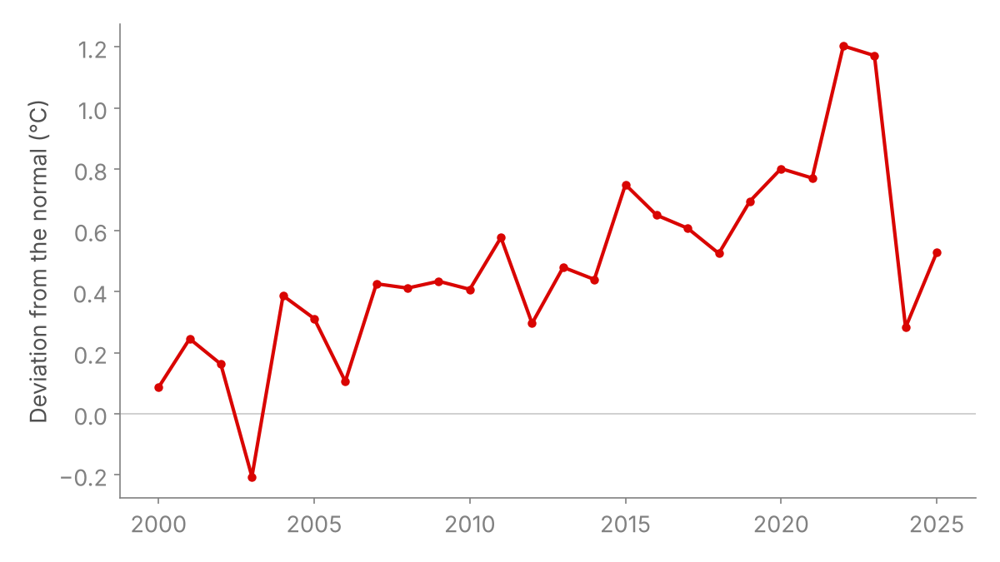
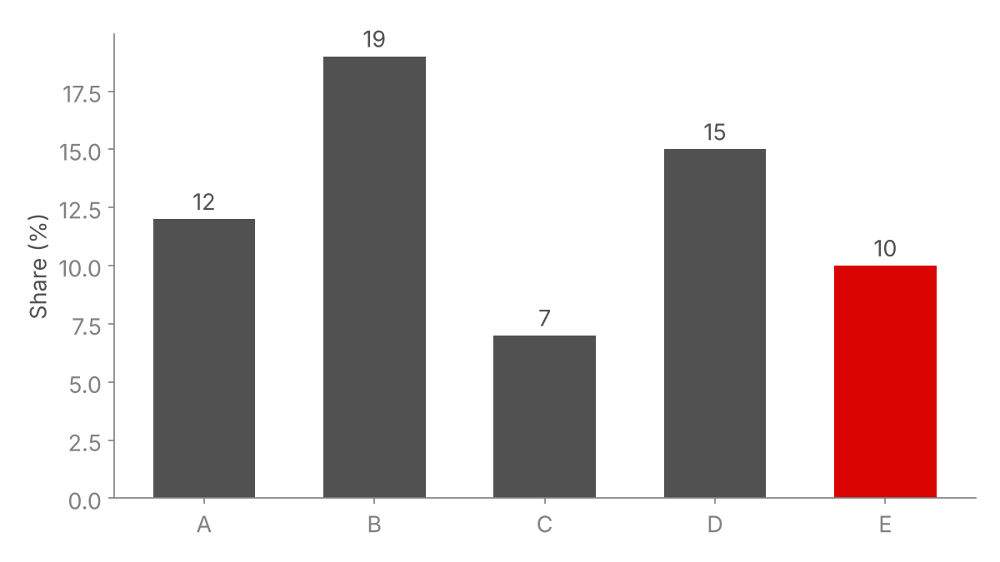

<!--
  ScPo revealjs template — example deck.
  Every slide below shows one feature of the template. Copy the ones you
  need, delete the rest. See README.md for the full list of classes.
-->

<!-- LaTeX macros available on every slide (MathJax). Keep this hidden div. -->
::: {.hidden}
$$
\newcommand{\independent}{\mathrel{\rlap{\perp}\mkern2mu\perp}}
\newcommand{\E}{\mathbb{E}}
$$
:::

```{r}
#| label: setup
#| include: false
knitr::opts_chunk$set(
  echo = FALSE, warning = FALSE, message = FALSE,
  fig.align = "center", dev = "png", dpi = 150
)
```

<!-- ===================================================================== -->
<!-- An opening "hook" slide: full red background, big centred text.       -->
<!-- ===================================================================== -->

# {.standout-red background-color="#d90502"}

One striking fact or question to open the talk.

Keep it to two or three sentences.

<!-- ===================================================================== -->
# Basics
<!-- A level-1 header (#) creates a centred section divider slide.        -->
<!-- ===================================================================== -->

## Text, emphasis and colours

- Plain text is set in Droid Serif; titles in Yanone Kaffeesatz.
- **Bold text is ScPo red** — use it for the one idea per bullet.
- Colour helpers: [blue]{.blue}, [grey]{.grey}, [light grey]{.lightgrey},
  [black]{.black}, [forest green]{.forestgreen}, [ScPo red]{.ScPored}.
- Inline code looks like `this`, and [links look like this](https://www.sciencespo.fr).
- A footnote goes at the bottom of the slide.^[Footnotes are styled by
  `.footnotes` in `scpo.css` (85% size, bottom of the slide).]
    - Nested bullets work as usual.

## Revealing content step by step

- This bullet is shown first.

. . .

- Three spaced dots on their own line (`. . .`) insert a pause.

. . .

An ordered list marked `.incremental` reveals one item per click, and
earlier items fade out:

::: {.incremental}
1. First step
2. Second step
3. Third step
:::

## Maths

The main specification:

$$
Y_{ijs} \;=\; \tau \, T_{m(j)s} \;+\; X_i\beta \;+\; \alpha_j \;+\; \delta_s \;+\; \varepsilon_{ijs}
$$

Macros defined in the hidden block at the top of the file work everywhere:

$$
T_{js} \independent \varepsilon_{ijs} \;\big|\; \alpha_j,\ \delta_s
\qquad\qquad
\E[\varepsilon_{ijs} \mid \alpha_j, \delta_s] = 0
$$

Inline maths too: $\hat\tau$ is identified from within-school, within-session
variation in $T$.

## Citations and speaker notes

- Narrative citation: @park2020heat find that hotter school days reduce
  learning.
- Parenthetical citation: weather shocks are a standard identification
  device [@dell2014weather].
- References are collected automatically on the last slide.

Press **S** during the talk to open the speaker view with these notes.

::: notes
Speaker notes go here. They are only visible in the speaker view (press S).
:::

<!-- ===================================================================== -->
# Layout
<!-- ===================================================================== -->

## Two columns

::: {.columns .cols-40-60}
::: {.col}
**Left column (40%)**

`.columns` + one `.col` per column gives equal widths. Add `.cols-40-60`,
`.cols-30-70` or `.cols-35-65` to the outer div for uneven splits.
:::

::: {.col}
**Right column (60%)**

{.col}
:::
:::


## Callouts

::: {.columns}
::: {.col}
::: {.callout-note title="Note"}
A neutral remark. Blue border.
:::

::: {.callout-tip title="Tip"}
A suggestion. Green border.
:::
:::

::: {.col}
::: {.callout-warning title="Warning"}
A caveat. Red border.
:::

::: {.callout-important title="Important"}
Something the audience must not miss.
:::
:::
:::

## Quotes

> Education is not the filling of a pail, but the lighting of a fire.

A blockquote gets a light grey rule on its left.

<!-- ===================================================================== -->
# Figures
<!-- ===================================================================== -->

## A single image, sized by width

{.vw60}

`{.vw50}`, `{.vw60}`, `{.vw70}`, `{.vw90}` set the width as a share of the
screen; `{.vh70}` sets the height instead.

## Image with a caption, centred in a column {.nostretch}

::: {.columns .cols-40-60}
::: {.col}
Use `{.col-center}` when the image should stay centred in its column,
with its caption underneath.
:::

::: {.col}
{.col-center}
:::
:::

## Two images side by side {.nostretch}

::: {.img-duo}
 
:::

## A 2 × 2 grid of images

::: {.grille-4}
::: {.columns}
::: {.col}


:::

::: {.col}


:::
:::
:::

## Image pinned to the bottom-right corner {.nostretch}

- `{.corner-br}` (small) or `{.corner-br-lg}` (larger) pins an image to the
  bottom-right corner, with its caption above it.
- Useful for a small map or a logo next to text.

{.corner-br-lg}

## {.nostretch}

{.fullslide}

## A figure computed in R

```{r}
#| label: example-plot
#| fig-width: 12
#| fig-height: 5
par(mar = c(4.5, 4.5, 1, 1), bty = "l", las = 1)
plot(cars$speed, cars$dist, pch = 19, col = "#d90502",
     xlab = "Speed (mph)", ylab = "Stopping distance (ft)")
abline(lm(dist ~ speed, data = cars), col = "#515151", lwd = 2)
```

Inline results work as well: the slope is
`r round(coef(lm(dist ~ speed, data = cars))[2], 2)` ft per mph.

<!-- ===================================================================== -->
# Tables
<!-- ===================================================================== -->

## A compact table with fine rules

::: {.fine-lines .smaller-reg}

| Dataset | Provider | Resolution | What it brings |
|---|---|---|---|
| School directory | DEPP | — | addresses, geolocation |
| SAFRAN | Météo-France | 8 km, daily | mean / min / max temperature |
| ERA5-Land | Copernicus | 9 km, hourly | hourly temperature |
| Exam dates | *Bulletin officiel* | exam × day | hand-keyed reference table |

:::

`.small-reg` (85%) and `.smaller-reg` (75%) shrink a table;
`.fine-lines` keeps only thin horizontal rules; `.no-lines` removes them.

## Table without any rules

::: {.no-lines .small-reg}

| | Model 1 | Model 2 | Model 3 |
|---|---:|---:|---:|
| Temperature | −0.012 | −0.010 | −0.009 |
| | (0.004) | (0.004) | (0.005) |
| School FE | ✓ | ✓ | ✓ |
| Session FE | | ✓ | ✓ |

:::

<!-- ===================================================================== -->
# Code
<!-- ===================================================================== -->

## Code with highlighted lines

```{.r code-line-numbers="3-4"}
library(data.table)
dt <- fread("panel.csv")
# these two lines are highlighted
dt[, anomaly := temp - normal]
dt[, .(mean_anomaly = mean(anomaly)), by = session]
```

Show the code of an R chunk with `#| echo: true`.

<!-- ===================================================================== -->
# Other slide styles
<!-- ===================================================================== -->

## Grey section divider {.title-slide-section-grey background-color="#515151"}

A full-colour, centred divider, in grey…

## Red section divider {.title-slide-section-red background-color="#d90502"}

… or in red.

## Inverse slide {.inverse background-color="#ffebf0"}

`{.inverse}` gives a light pink background and blue titles — handy for a
recap or an aside.

## {.standout}

**One centred message, no title.**

## Jumping to the appendix and back

Buttons link to any slide that has an anchor `{#my-anchor}`:

[Details in the appendix](#app-details){.button}

- `[label](#anchor){.button}` — red, for "go deeper".
- `[label](#anchor){.button .back}` — grey, for "go back".

Put the button on the main slide, and a `.back` button on the appendix
slide pointing to where you came from.

<!-- ===================================================================== -->
<!-- Closing slide                                                         -->
<!-- ===================================================================== -->

# {.standout-red background-color="#d90502"}

Thank you!

<!-- ===================================================================== -->
# Appendix {.appendix}
<!-- Everything after a level-1 header with {.appendix} is left out of the -->
<!-- slide count (uncounted_appendix.lua).                                 -->
<!-- ===================================================================== -->

## Appendix slide {#app-details}

The slide counter stops at the "Thank you" slide: appendix slides are
uncounted.

[Back to the main slides](#jumping-to-the-appendix-and-back){.button .back}

## References

::: {#refs}
:::
